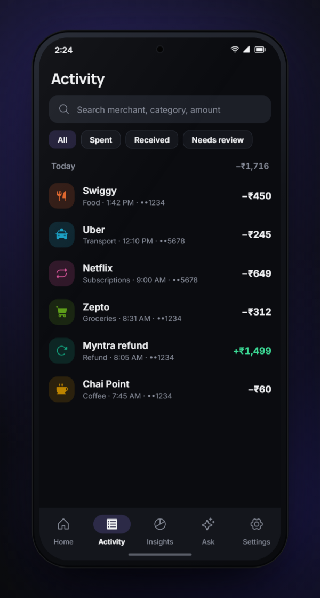
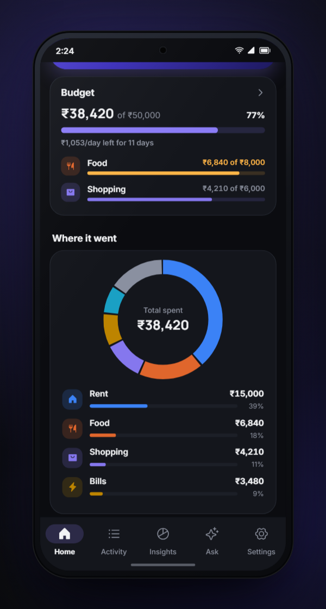
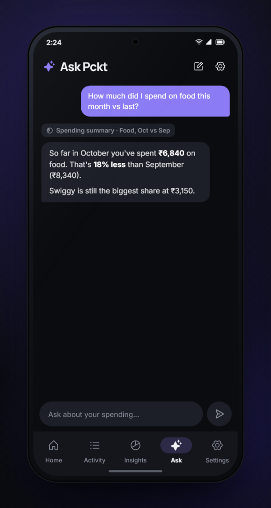

<h1 align="center">Pckt</h1>

<p align="center"><b>A free, open-source finance tracker that fills itself in.</b></p>

<p align="center">
  <a href="LICENSE"></a>
  
  <a href="https://github.com/pritam-ravani/pckt/releases/latest"></a>
  <a href="https://github.com/pritam-ravani/pckt/stargazers"></a>
</p>

<p align="center"></p>

<p align="center">
  <a href="https://github.com/pritam-ravani/pckt/releases/latest"></a>
  <br><sub>Android 11+, 64-bit · free, no account, no ads</sub>
</p>

<p align="center">
  
  
  
</p>

Pckt reads the bank, card and UPI alerts already arriving on your phone by SMS and email, turns them
into transactions, merges the copies, and sorts each one into a category. You don't type anything
in. Everything stays in an encrypted database on your phone. If you want AI help, you connect your
own LLM (cloud or on-device); Pckt has no server and no account.

Built for India first (Indian bank SMS formats, UPI references and VPAs, NACH/IMPS/NEFT, lakh/crore
grouping), and works with 30+ currencies: pick your home currency, and spends abroad keep theirs.

## The idea

Most people already have a perfect record of their spending: every payment sends an SMS, and
often an email too. What's missing is software that reads those messages *on your phone* and doesn't
send them to someone else's server.

- **Messages in, transactions out.** A rule-based parser understands Indian bank alerts (sender
  IDs, amounts, account last-4, UPI refs, merchants) and reads amounts in any currency ("USD 12.50",
  "£8.40", "AED 120.00"), so generic card and bank alerts from elsewhere parse too, flagged for a
  quick review. Messages the rules can't read can optionally go to your LLM.
- **One payment, one row.** The same ₹450 Swiggy order shows up as a bank SMS, a bank email and a
  Swiggy receipt. A scoring dedup engine (same reference, account, time, merchant, channel) merges
  them, and you can see why each merge happened and undo it. Transfers between your own accounts are
  recognised and kept out of spend.
- **Learns your categories.** When you fix a category, it becomes a merchant rule. Your edits always
  beat the AI.
- **Bring your own brain.** Plug in OpenAI-compatible (OpenAI, OpenRouter, Groq, Ollama…),
  Anthropic or Gemini keys, or download a Gemma model that runs entirely on the phone. The **Ask**
  tab is an agent with tools over your local data ("How much did I spend on food in September vs
  August?"), and it asks before changing anything.

## How it compares

| | **Pckt** | **Oinkoin** | **Axio** (ex-Walnut) | **YNAB / Monarch** |
|---|---|---|---|---|
| Price | Free | Free, paid Pro | Free (makes money on loans / credit) | Subscription, about US$100/year |
| Source | Open (GPL-3.0) | Open (GPL-3.0) | Closed | Closed |
| How transactions get in | **Automatic** from SMS + email, share sheet | Typed in by hand | Automatic from SMS | Bank sync (mostly US/EU banks) |
| SMS + email dedup | ✓ | — | — | n/a |
| Where data lives | Your phone, encrypted (SQLCipher) | Your phone | Their cloud | Their cloud |
| Account needed | No | No | Yes | Yes |
| AI | Optional: your own key or fully on-device | — | — | Vendor's own, in their cloud (Monarch) |
| Budgets, recurring, export | ✓ | ✓ (recurring and backup are Pro) | Budgets, bill reminders | ✓ |
| Platforms | Android (iOS via Shortcuts, untested) | Android, Linux, Windows | Android, iOS | Web, iOS, Android |

**Oinkoin** is the closest in spirit and the inspiration: open source, offline, no ads. But every
entry is typed by hand, and backup and recurring records are Pro features. Pckt keeps that privacy and
openness but does the data entry for you, and everything is free.

**Paid and "free" commercial apps** either sync through bank aggregators (YNAB, Monarch; little Indian
bank coverage, and a subscription), or read your SMS but pay for themselves with lending and credit
products and keep your data in their cloud (Axio and similar Indian apps). Pckt reads the same SMS on
the device and has nothing to sell you.

*Comparison based on each app's public pages as of October 2026; pricing and features change.*

## Features

- Automatic import from SMS (history + real-time alerts) and email (IMAP app passwords for Gmail,
  Outlook, Yahoo, Zoho or any server; optional Gmail OAuth)
- Share any message or receipt into Pckt, plus a `pckt://ingest` link for iOS Shortcuts
- Dashboard, activity feed, insights charts, budgets per category, recurring payment detection
- A home currency (31 to choose from, defaulted from the phone's region) for totals, budgets and the
  assistant; transactions and accounts keep their own currency, with correct decimals (¥1,200,
  KWD 12.500) and Indian grouping only for rupees
- Edit transactions, manage accounts and categories; every source message is inspectable
- Optional AI: read unusual messages, categorise leftovers, chat with your finances
- On-device Gemma 4 / Qwen3 picked for your phone's RAM and chip, downloaded once over Wi-Fi
- Encrypted database, optional biometric app lock, hidden from screenshots and recents, no cloud
  backup; CSV export and full JSON backup/restore

## Install

1. Download `pckt-v*.apk` from [Releases](https://github.com/pritam-ravani/pckt/releases).
2. Open it on your phone and allow installing from your browser/files app.
3. Grant SMS access when Pckt asks. It reads your inbox once, then keeps up as new alerts arrive.

## Setup guides

<details>
<summary><b>Connect your email</b></summary>

Settings → Sources → Email → Connect. Pckt only downloads mail from known bank, card, UPI and
merchant senders (or with payment words in the subject) and runs it through the same pipeline as
SMS, so an email and its SMS become one transaction. The password is kept in the Android keystore.

| Provider | Steps | Server |
|---|---|---|
| Gmail | Turn on 2-Step Verification (myaccount.google.com/security) → myaccount.google.com/apppasswords → create "Pckt" → paste the 16 characters | imap.gmail.com:993 |
| Outlook / Hotmail | Two-step verification → Advanced security options → app password. Microsoft is phasing out password IMAP for personal accounts; if it fails, forward alerts to Gmail/Zoho | outlook.office365.com:993 |
| Yahoo | login.yahoo.com/account/security → Generate app password | imap.mail.yahoo.com:993 |
| Zoho | Enable IMAP access in Mail settings; with 2FA create an app-specific password | imap.zoho.in:993 (imap.zoho.com outside India) |
| Other | Any IMAP server, SSL (993) or STARTTLS (143) | — |

"Sign in with Google" appears only in builds made with your own OAuth client id; see
[ARCHITECTURE.md](ARCHITECTURE.md#gmail-sign-in-oauth-optional).

</details>

<details>
<summary><b>Connect an AI (your own key or on the phone)</b></summary>

Settings → *Connect your LLM*. Requests go straight from the phone to the provider you
pick; there is no Pckt server. Models are listed live from the provider's models endpoint
(free text works too).

| Provider | API | Notes |
|---|---|---|
| OpenAI, OpenRouter, Groq, DeepSeek, any OpenAI-compatible | Chat Completions + `tools` | configurable base URL |
| Ollama / LM Studio on your computer | OpenAI-compatible at `http://<LAN-IP>:11434/v1` / `:1234/v1` | key optional; pick a model with tool calling |
| Anthropic Claude | Messages API + tool use | |
| Google Gemini | `generateContent` + function declarations | |
| On this phone (Gemma) | LiteRT-LM via `flutter_edge_ai` | model picked for the device, downloaded once; see below |

What it does:

- **AI reading** of messages the rules flagged as unreadable. The answer is strict JSON, validated
  (the amount must literally appear in the message), and fed through the same dedup → categorise →
  store path as rule-parsed messages, so an AI-read email still merges with its SMS. Non-transactions
  are ignored with an `AI: …` reason. AI-read transactions are marked for a quick review.
- **AI categorisation** of transactions left in *Other* / *Other Income*. Names are validated against
  your categories; confident merchant-level answers become merchant rules, so the rule engine learns.
  AI choices are never locked — your own edits always win.
- **Ask** tab: an agent (max 8 tool steps) with `query_transactions`, `spending_summary`,
  `list_categories`, `list_accounts`, `find_recurring` and `recategorize` (asks you to confirm first).

#### Privacy

The API key is stored in the Android keystore (flutter_secure_storage); provider, URL, model and
toggles in SharedPreferences under `llm.*`. Nothing is sent until a provider is saved **and** the
matching switch is on:

| Switch | Default | What leaves the phone |
|---|---|---|
| AI categorisation | on | merchant, counterparty/VPA, amount, direction, payment mode, date |
| AI reading of unreadable messages | **off** | the full text and sender of those messages |
| Assistant chat | on | your questions + structured tool results (totals, matching transactions); never raw messages |

#### On-device models

Settings → Connect your LLM → *On this phone (Gemma)*. Pckt recommends the most capable model that
fits your phone:

| Model | Download | Picked when | Ask tab |
|---|---|---|---|
| Gemma 4 E4B | 3.4 GB | ≥ 10.5 GB RAM | ✓ |
| Gemma 4 E2B | 2.4 GB | ≥ 5.2 GB RAM (6 GB phones) | ✓ |
| Gemma 3 1B | 0.6 GB | small phones, with a Hugging Face token (gated licence) | — |
| Qwen3 0.6B | 0.3 GB | small phones, no token | ✓ |

Models download once, over Wi-Fi only (mobile data is never used without asking). On a mid-range
6 GB phone, a multi-step Ask answer can take minutes.

</details>

<details>
<summary><b>Currencies</b></summary>

- **Home currency.** Chosen at onboarding (defaulted from the phone's region) and in
  Settings → Money → Currency. Existing installs keep INR. Totals, budgets, charts, notifications,
  the assistant and its tools use it. Budgets remember their currency and pause if you switch.
- **Foreign transactions.** Pckt has no server and never fetches exchange rates. A message that
  states the home-currency equivalent is stored with both amounts and counts at once. Otherwise the
  transaction keeps its own currency, is shown with "not in totals", and you add what the bank
  charged (or a rate) from the transaction; until then it is left out of totals rather than guessed.
  The dashboard says how many are waiting.
- **Supported:** INR, AED, SAR, QAR, KWD, OMR, BHD, SGD, MYR, USD, GBP, CAD, AUD, NZD, EUR, BDT, PKR,
  LKR, NPR, IDR, PHP, VND, THB, NGN, KES, ZAR, BRL, MXN, TRY, JPY, KRW.

</details>

<details>
<summary><b>Instant alerts</b></summary>

When a bank SMS arrives, Pckt posts *"₹250 debited · HDFC — Tap to review"*. Tapping opens Pckt,
which adds it. Turn it off in Settings → SMS → *Instant alerts*.

</details>

<details>
<summary><b>Share to Pckt & iOS Shortcuts</b></summary>

Any text can be fed through the normal pipeline (parse → dedup → categorise → store) as source
`shortcut`; a snackbar says whether it was added, matched an existing transaction or ignored.

- **Android share sheet:** long-press a bank SMS → Share → Pckt.
- **Link:** `pckt://ingest?text=<url-encoded message>&sender=<url-encoded sender>` (`sender` is
  optional; without it the bank is guessed from the text). Works on Android and iOS.

iOS gives apps no SMS access, but a Shortcuts automation can forward each bank message:

1. Shortcuts → **Automation** → **+** → **Message**. *Message Contains*: `debited` (make a second
   automation for `credited`, and for `spent` if your card SMS use it). Choose **Run Immediately**.
2. Add **URL Encode** → input: *Shortcut Input* → **Content** (tap the variable to pick it).
3. Add a second **URL Encode** → input: *Shortcut Input* → **Sender**.
4. Add **Text**: `pckt://ingest?text=` *URL Encoded Text (1)* `&sender=` *URL Encoded Text (2)*.
5. Add **Open URLs** with that Text.

Each matching message then opens Pckt briefly and shows what was recorded. Sharing the same message
twice is a no-op (content-hashed id), and a message that also arrives by email is merged by dedup.

</details>

<details>
<summary><b>Export & backup</b></summary>

Settings → Data:

- **Export transactions (CSV)** — date, amount, direction, merchant, category, account, mode,
  reference, note, sources, currency, converted amount and its currency (amounts use the currency's
  decimals); UTF-8 with BOM so Excel shows symbols and names correctly.
- **Back up everything** — a JSON dump of every table (accounts, categories, transactions, raw
  messages, merchant rules and anything added later) with format and schema versions.
- **Restore from backup** — validates the file (format, schema version not newer than the app,
  required tables), shows what it contains, and after confirmation replaces all data in a single
  DB transaction (nothing changes if anything fails). Backups from v1.0 restore with every amount in
  INR.

Files go out through the share sheet or a *Save to device* dialog.

</details>

## Contributing

Issues and pull requests are welcome, especially **SMS and email formats from banks Pckt doesn't
read yet**. See [CONTRIBUTING.md](CONTRIBUTING.md). Please remove real names, account numbers and
references from any sample message you share.

## License

[GPL-3.0](LICENSE). You can use, study, change and share Pckt. If you distribute a modified
version, you must publish its source under the same license.

## Roadmap

- [x] Phase 1 — app shell, theme, DB, dashboard, activity, insights, manual entry
- [x] Phase 2 — Android SMS import + parser, dedup, auto-categorisation, account discovery
- [x] Phase 3 — Email: IMAP with app passwords (Gmail, Outlook, Yahoo, Zoho, any IMAP) + optional
      Gmail OAuth (`gmail.readonly`); email parser feeding the same pipeline, SMS↔email dedup
- [x] Phase 4 — Bring-your-own LLM: OpenAI-compatible / Anthropic / Gemini, key in secure storage;
      LLM fallback for unreadable messages; agent chat with tools over the local DB
- [x] Phase 5 — budgets, recurring payments, editing, SQLCipher encryption, app lock, on-device Gemma
      models, iOS Shortcuts / share bridge, real-time SMS alerts, CSV export & JSON backup
- [x] v1.0.1 — multi-currency: home currency, per-transaction and per-account currency, foreign card
      spends, currency-agnostic SMS amounts for alerts from outside India
- [ ] Next — bank sender lists and formats for the Gulf, UK, US and Singapore, iOS testing, Qualcomm
      NPU opt-in, F-Droid

## Development

```sh
flutter pub get
dart run build_runner build -d   # drift codegen
flutter run                      # phone connected with USB debugging on
flutter test
```

How the parser, dedup engine, database, encryption, LLM integration and release builds work is in
[ARCHITECTURE.md](ARCHITECTURE.md).
