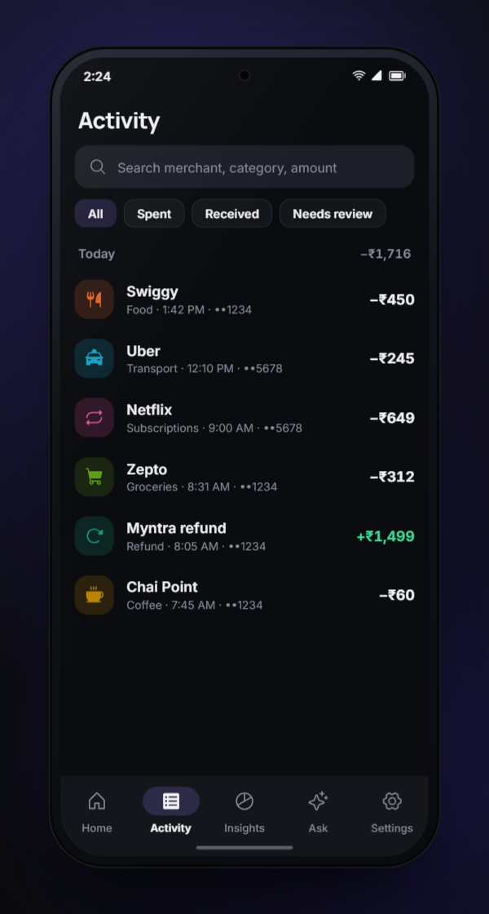
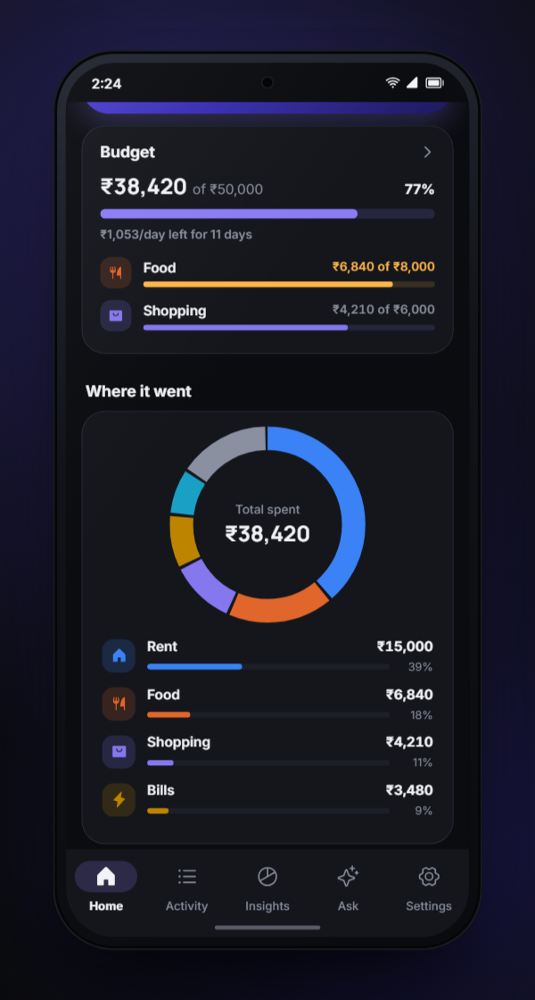
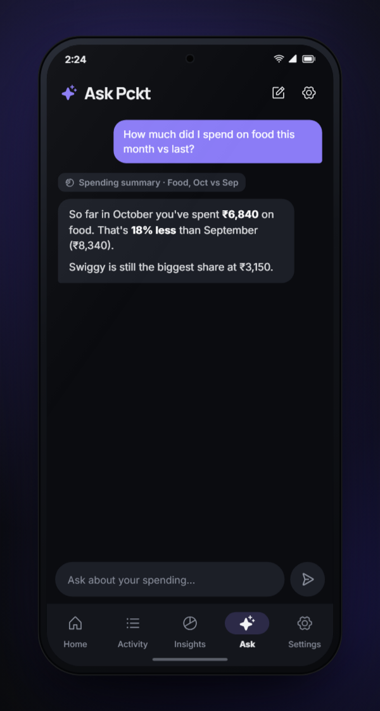

<h1 align="center">PennyWise</h1>

<b>A private personal finance manager for India that fills itself in.</b>

  Android 11+ (64-bit) · free · open source (GPL-3.0) · no account · no server · your data stays on your phone

> PennyWise is a modified version of [Pckt](https://github.com/pritam-ravani/pckt) by pritam-ravani, licensed
> under GPL-3.0. Modifications began on 2026-11-10; see [NOTICE](NOTICE). The screenshots below were captured
> from Pckt.

  
  
  

## What it is

Every payment you make already leaves a trace: a bank SMS, an email, a Paytm or PhonePe notification.
PennyWise collects those on your phone, turns them into one clean list of transactions, sorts them into
categories and shows where your money goes. Your salary, payslip deductions and company food sit alongside,
so you can see what you earn, what you spend and what you keep.

Nothing is uploaded. There is no PennyWise server and no sign-up. AI help is optional, and you choose
whether it uses your own API key or runs entirely on the phone.

It is built for India first: Indian bank SMS formats, UPI references, lakh/crore grouping and everyday
categories like tiffin, PG rent and maid. It also handles 30+ other currencies.

## Features

### Transactions that add themselves

| Source | What happens |
|---|---|
| **Bank SMS** | Reads your inbox once, then keeps up as alerts arrive, with an optional instant "₹250 debited" notification |
| **Email** | Reads bank, card and merchant mails over IMAP (Gmail, Outlook, Yahoo, Zoho or any server) |
| **Google Pay, Paytm, PhonePe** | Optional: sees a payment app's notification, saves the payment and asks "₹250 to Swiggy: Food Delivery?" with one-tap category buttons |
| **Paytm statement** | Imports the free Excel UPI statement from Paytm, using your Paytm tags as categories |
| **Share sheet** | Share any message or receipt into PennyWise |
| **Manual entry** | Quick add with payment type, account, your most-used merchants as shortcuts, and a duplicate warning |

The same payment often arrives several ways, for example an SMS, an email and a Swiggy receipt.
PennyWise merges them into one transaction and shows why. Money moved between your own accounts is
kept out of spending.

### Understand your money

- **Dashboard and insights:** monthly spend and income, category breakdown, trends and your biggest expenses.
- **63 categories** for real life in India, from Food Delivery, Tiffin & Mess and PG & Hostel to Family
  Support, Festivals & Pooja and Bonus. Rename, reorder, add or remove any of them.
- **Learns as you go:** fix a category once and that merchant is remembered.
- **Budgets** per category or overall, with alerts at 80% and 100%.
- **Recurring payments:** subscriptions and regular bills found automatically.

### Salary and payslips

- Enter a payslip once: Basic, HRA, allowances, bonus, PF, professional tax, TDS, company food and any
  lines of your own. The next month starts from the last one.
- Net pay is matched to the salary credit in your bank and filed under Salary.
- A monthly breakdown shows gross → deductions → net pay → spent → left over.
- Food in one number: company food deductions plus your own food spending.

### Reminders

- Pick any times and weekdays, up to 12 a day.
- Each alert shows how many payments need review, with **Review** and **Add transaction** buttons.
- Optionally stays quiet when nothing needs review.

### Optional AI

- Connect OpenAI-compatible services (OpenAI, OpenRouter, Groq, Ollama…), Anthropic or Gemini with your
  own key, or download a Gemma or Qwen model that runs on the phone.
- **Ask** answers questions such as "How much did I spend on food in October?" from your own data.
- AI can read messages the rules couldn't, and suggest categories for leftovers. Your own choices always win.

### Privacy and security

- Encrypted database (SQLCipher, AES-256) with the key in the Android keystore.
- Password-protected backups. Older plain backups still restore.
- Optional fingerprint or face lock, and hiding the app from screenshots and recent apps.
- No cloud backup and no analytics. Fonts ship inside the app.

## What leaves your phone

Nothing, unless you turn on a feature that needs it:

| Feature | Sends | To |
|---|---|---|
| Email import | your login, to fetch mail | your own mail provider |
| AI categorisation (on once an AI is connected) | merchant, amount, date and payment type | the AI provider you chose |
| AI reading of unreadable messages (off by default) | the text of those messages | the AI provider you chose |
| Ask | your question and summaries of matching transactions | the AI provider you chose |
| On-device AI | one model download | Hugging Face |

With an on-device model, nothing is sent at all. Payment app alerts read only Google Pay, Paytm and PhonePe
notifications and send nothing anywhere.

## Getting started

PennyWise isn't on an app store yet. You build the APK yourself and install it on your phone; see
[TECHNICAL.md](TECHNICAL.md) for the build steps. Then:

1. **Set your currency:** Settings → Money → Currency → INR.
2. **Connect SMS:** grant SMS access when asked. Past alerts are read once, then new ones arrive automatically.
3. **Optional, payment app alerts:** Settings → Sources → Payment app alerts. On Android 13 and later, first
   open PennyWise's **App info**, tap **⋮** and choose **Allow restricted settings**. Then allow
   **Notification access**, and set **Battery** to allow background activity.
4. **Optional:** import a Paytm statement, add your payslip, and set reminders.
5. **Back up regularly:** Settings → Data → Back up everything. Keep the password safe, because a lost
   password can't be recovered.

To start fresh after trying it out, Settings → Data → **Reset imported data** clears transactions and
messages but keeps your categories and learned rules.

<b>Connect your email</b>

Settings → Sources → Email → Connect. Only mail from known bank, card, UPI and merchant senders (or with
payment words in the subject) is downloaded. The password stays in the Android keystore.

| Provider | Steps | Server |
|---|---|---|
| Gmail | Turn on 2-Step Verification → myaccount.google.com/apppasswords → create "PennyWise" → paste the 16 characters | imap.gmail.com:993 |
| Outlook / Hotmail | Two-step verification → Advanced security options → app password. If it fails, forward alerts to Gmail or Zoho | outlook.office365.com:993 |
| Yahoo | login.yahoo.com/account/security → Generate app password | imap.mail.yahoo.com:993 |
| Zoho | Enable IMAP in Mail settings; with 2FA, create an app-specific password | imap.zoho.in:993 |
| Other | Any IMAP server, SSL (993) or STARTTLS (143) | — |

<b>Connect an AI</b>

Settings → *Connect your LLM*. Requests go straight from the phone to the provider you pick.

| Provider | Notes |
|---|---|
| OpenAI, OpenRouter, Groq, DeepSeek or any OpenAI-compatible API | configurable base URL |
| Ollama or LM Studio on your computer | e.g. `http://<LAN-IP>:11434/v1`; pick a model with tool calling |
| Anthropic Claude | your API key |
| Google Gemini | your API key |
| On this phone | Gemma 4 E4B (3.4 GB), Gemma 4 E2B (2.4 GB), Gemma 3 1B (0.6 GB) or Qwen3 0.6B (0.3 GB), picked for your phone's memory and downloaded once over Wi-Fi |

On a mid-range phone with 6 GB of memory, an on-device answer can take a few minutes.

<b>Import a Paytm statement</b>

In Paytm, open **Balance & History** → **Download UPI Statement** and choose **Excel**. In PennyWise, go to
Settings → Sources → Import Paytm statement and pick the file. It is read on the phone. Payments already
imported are skipped, and ones already found in SMS are matched instead of added again.

<b>Currencies</b>

Pick a home currency for totals and budgets; foreign spends keep their own currency. PennyWise never fetches
exchange rates. A foreign spend counts once the message states the rupee amount or you add it, and until
then it is shown as "not in totals". Supported: INR, AED, SAR, QAR, KWD, OMR, BHD, SGD, MYR, USD, GBP, CAD,
AUD, NZD, EUR, BDT, PKR, LKR, NPR, IDR, PHP, VND, THB, NGN, KES, ZAR, BRL, MXN, TRY, JPY, KRW.

<b>Export and backup</b>

Settings → Data:

- **Export transactions (CSV)** opens in Excel, Sheets or Numbers.
- **Back up everything** saves all your data, protected with a password you choose.
- **Restore from backup** checks the file, shows what's inside and replaces everything only after you confirm.

<b>iPhone</b>

The app has iOS code but hasn't been tested on an iPhone. iOS gives apps no access to SMS, so the closest
option is a Shortcuts automation that sends each bank message to PennyWise through a
`pckt://ingest?text=…&sender=…` link.

## Status and roadmap

| Area | Status |
|---|---|
| SMS, email, share sheet, manual entry, Paytm import | ✓ |
| Dedup, categories, budgets, recurring payments, insights | ✓ |
| Salary and payslips, encrypted backups | ✓ |
| Payment app alerts, reminders | ✓ (alert wording still being tuned against real payments) |
| Optional cloud and on-device AI | ✓ |
| Credit cards and Amazon Pay Later | Planned |
| Necessary / optional / avoidable / growth spending labels | Planned |
| Savings goals, cash flow and predictions | Planned |
| A stronger AI assistant that knows about salary and plans | Planned |
| iPhone | Untested |

## Contributing

Issues and pull requests are welcome, especially bank SMS and email formats PennyWise doesn't read yet. See
[CONTRIBUTING.md](CONTRIBUTING.md) and [TECHNICAL.md](TECHNICAL.md). Please remove names, account numbers and
reference numbers from any sample message you share.

## License and credits

[GPL-3.0](LICENSE). You can use, study, change and share PennyWise. If you distribute a modified version, you
must publish its source under the same licence.

PennyWise is based on [Pckt](https://github.com/pritam-ravani/pckt) by pritam-ravani. It bundles the Inter
and Manrope fonts under the SIL Open Font License; see [NOTICE](NOTICE).
