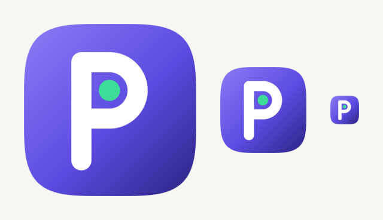

<p align="center"></p>

# Pckt

**A free, open-source finance tracker that fills itself in.** Pckt reads the bank, card and UPI
alerts already arriving on your phone by SMS and email, turns them into transactions, merges the
copies, and sorts each one into a category. You don't type anything in. Everything stays in an
encrypted database on your phone. If you want AI help, you connect your own LLM (cloud or
on-device); Pckt has no server and no account.

Built for India first: Indian bank SMS formats, UPI references and VPAs, NACH/IMPS/NEFT, ₹ everywhere.

[Download the latest APK](https://github.com/pritam-ravani/pckt/releases/latest) · Android 11+, 64-bit ·
GPL-3.0

## The idea

Most people already have a perfect record of their spending: every payment sends an SMS, and
often an email too. What's missing is software that reads those messages *on your phone* and doesn't
send them to someone else's server.

- **Messages in, transactions out.** A rule-based parser understands Indian bank alerts (sender
  IDs, amounts, account last-4, UPI refs, merchants). Messages the rules can't read can optionally go
  to your LLM.
- **One payment, one row.** The same ₹450 Swiggy order shows up as a bank SMS, a bank email and a
  Swiggy receipt. A scoring dedup engine (same reference, account, time, merchant, channel) merges
  them, and you can see why each merge happened and undo it. Transfers between your own accounts are
  recognised and kept out of spend.
- **Learns your categories.** When you fix a category, it becomes a merchant rule. Your edits always
  beat the AI.
- **Bring your own brain.** Plug in OpenAI-compatible (OpenAI, OpenRouter, Groq, Ollama…),
  Anthropic or Gemini keys, or download a Gemma model that runs entirely on the phone. The **Ask**
  tab is an agent with tools over your local data ("How much did I spend on food in September vs
  August?"), and it asks before changing anything.

## How it compares

| | **Pckt** | **Oinkoin** | **Axio** (ex-Walnut) | **YNAB / Monarch** |
|---|---|---|---|---|
| Price | Free | Free, paid Pro | Free (makes money on loans / credit) | Subscription, about US$100/year |
| Source | Open (GPL-3.0) | Open (GPL-3.0) | Closed | Closed |
| How transactions get in | **Automatic** from SMS + email, share sheet | Typed in by hand | Automatic from SMS | Bank sync (mostly US/EU banks) |
| SMS + email dedup | ✓ | — | — | n/a |
| Where data lives | Your phone, encrypted (SQLCipher) | Your phone | Their cloud | Their cloud |
| Account needed | No | No | Yes | Yes |
| AI | Optional: your own key or fully on-device | — | — | Vendor's own, in their cloud (Monarch) |
| Budgets, recurring, export | ✓ | ✓ (recurring and backup are Pro) | Budgets, bill reminders | ✓ |
| Platforms | Android (iOS via Shortcuts, untested) | Android, Linux, Windows | Android, iOS | Web, iOS, Android |

**Oinkoin** is the closest in spirit and the inspiration: open source, offline, no ads. But every
entry is typed by hand, and backup and recurring records are Pro features. Pckt keeps that privacy and
openness but does the data entry for you, and everything is free.

**Paid and "free" commercial apps** either sync through bank aggregators (YNAB, Monarch; little Indian
bank coverage, and a subscription), or read your SMS but pay for themselves with lending and credit
products and keep your data in their cloud (Axio and similar Indian apps). Pckt reads the same SMS on
the device and has nothing to sell you.

*Comparison based on each app's public pages as of October 2026; pricing and features change.*

## Features

- Automatic import from SMS (history + real-time alerts) and email (IMAP app passwords for Gmail,
  Outlook, Yahoo, Zoho or any server; optional Gmail OAuth)
- Share any message or receipt into Pckt, plus a `pckt://ingest` link for iOS Shortcuts
- Dashboard, activity feed, insights charts, budgets per category, recurring payment detection
- Edit transactions, manage accounts and categories; every source message is inspectable
- Optional AI: read unusual messages, categorise leftovers, chat with your finances
- On-device Gemma 4 / Qwen3 picked for your phone's RAM and chip, downloaded once over Wi-Fi
- Encrypted database, optional biometric app lock, hidden from screenshots and recents, no cloud
  backup; CSV export and full JSON backup/restore

## Install

1. Download `pckt-v*.apk` from [Releases](https://github.com/pritam-ravani/pckt/releases).
2. Open it on your phone and allow installing from your browser/files app.
3. Grant SMS access when Pckt asks. It reads your inbox once, then keeps up as new alerts arrive.

## Contributing

Issues and pull requests are welcome, especially **SMS and email formats from banks Pckt doesn't
read yet**. See [CONTRIBUTING.md](CONTRIBUTING.md). Please remove real names, account numbers and
references from any sample message you share.

## License

[GPL-3.0](LICENSE). You can use, study, change and share Pckt. If you distribute a modified
version, you must publish its source under the same license.

---

# Development

## Run

```sh
flutter pub get
dart run build_runner build -d   # drift codegen
flutter run                      # phone connected with USB debugging on
flutter test                     # parser, dedup pipeline, LLM providers, agent
```

## Architecture

```
lib/
  ingestion/            source-agnostic pipeline: RawInput → parse → dedup → categorise → store
    parser/             rule-based SMS parser (bank sender ids, amounts, refs, VPAs, merchants)
    dedup/              scoring engine that merges the same payment seen via multiple sources
    categorizer.dart    learned merchant rules → structural hints → keyword lists → fallback
    sms/                Android SMS inbox reader (MethodChannel `pckt/sms`, see MainActivity.kt)
    email/              IMAP (enough_mail) + Gmail API sources, HTML→text, EmailSyncController
    parser/email_*      email parser: sender-domain directory, bank alerts via SMS rules, merchant receipts
  data/db/              drift schema: accounts, categories, transactions, raw_messages, merchant_rules
  llm/                  bring-your-own LLM: LlmClient + OpenAI-compatible / Anthropic / Gemini clients,
                        fallback parser, AI categoriser, agent + tools over the local DB
  features/             dashboard, activity, insights, assistant (Ask), settings, onboarding
  core/theme/           palette (validated categorical colors), typography, icon map
```

### Deduplication

Every raw message is kept in `raw_messages` and linked to the transaction it
produced or merged into, so merges are explainable and reversible.

| Signal | Effect |
|---|---|
| Same UPI ref / RRN | certain match |
| Different refs | certain non-match |
| Same account last-4 | +0.25 (different: −0.5) |
| Time proximity | +0.45 (≤5 min) … +0.1 (≤24 h) |
| Merchant token overlap | +0.2 (none: −0.1) |
| SMS ↔ email (different channels), no merchant/account conflict | +0.3 (≤30 min), +0.15 (≤3 h) |
| Same sender already reported it | −0.35 (two real ₹20 chais) |

≥ 0.75 merges automatically; 0.5–0.75 creates a *possible duplicate* the user confirms.
Merchant tokens include brand aliases for the legal names banks print (BUNDL → Swiggy,
Eternal → Zomato, …). When a merchant receipt email (Swiggy, Amazon, Uber…) merges
into a bank alert, its merchant name replaces the bank's and the category is re-derived
unless the user set one.
A debit from one own account and an equal credit to another within an hour is
marked as a self-transfer and excluded from spend/income.

## Email

Settings → Sources → Email → Connect. Pckt searches the INBOX since the chosen
import window (1/3/6/12 months, then incrementally with a 1-day overlap, max 400
messages per sync) for mail from known bank / card / UPI / merchant domains or with
payment words in the subject, downloads only those, converts HTML to text and runs
them through the same parse → dedup → categorise pipeline as SMS. Network and MIME
work runs in a background isolate. Settings live in SharedPreferences (`email.*`);
the password only in the Android keystore (`SecretStore`). Inspect shows every
email and why it was parsed, merged or ignored.

### App passwords (IMAP, no setup needed)

| Provider | Steps | Server |
|---|---|---|
| Gmail | Turn on 2-Step Verification (myaccount.google.com/security) → myaccount.google.com/apppasswords → create "Pckt" → paste the 16 characters | imap.gmail.com:993 |
| Outlook / Hotmail | Two-step verification → Advanced security options → app password. Microsoft is phasing out password IMAP for personal accounts; if it fails, forward alerts to Gmail/Zoho | outlook.office365.com:993 |
| Yahoo | login.yahoo.com/account/security → Generate app password | imap.mail.yahoo.com:993 |
| Zoho | Enable IMAP access in Mail settings; with 2FA create an app-specific password | imap.zoho.in:993 (imap.zoho.com outside India) |
| Other | Any IMAP server, SSL (993) or STARTTLS (143) | — |

### Gmail sign-in (OAuth, optional)

"Sign in with Google" (Gmail REST API, `gmail.readonly`) only appears when the build
has an OAuth client id. One-time Google Cloud setup:

1. console.cloud.google.com → create a project → *APIs & Services → Library* → enable **Gmail API**.
2. *OAuth consent screen*: External, app name "Pckt", add scope
   `https://www.googleapis.com/auth/gmail.readonly`, add your Google account as a **test user**
   (Testing mode is enough for personal use; `gmail.readonly` is a restricted scope, so
   publishing would need Google verification).
3. *Credentials → Create credentials → OAuth client ID → Android*: package name
   `com.pckt.pckt`, SHA-1 of the signing key. For debug builds:
   ```sh
   keytool -list -v -keystore ~/.android/debug.keystore -alias androiddebugkey -storepass android -keypass android
   ```
   (Release builds need the release key's SHA-1 as a second Android client.)
4. *Create credentials → OAuth client ID → Web application* (no redirect URIs needed). Android's
   Credential Manager uses this one as the *server client id*.
5. Build with the **Web** client id:
   ```sh
   flutter run --dart-define=GOOGLE_OAUTH_CLIENT_ID=1234567890-abc.apps.googleusercontent.com
   ```

Without the define the button is hidden and app passwords are used.
## Bring your own LLM

Settings → *Connect your LLM*. Requests go straight from the phone to the provider you
pick; there is no Pckt server. Models are listed live from the provider's models endpoint
(free text works too).

| Provider | API | Notes |
|---|---|---|
| OpenAI, OpenRouter, Groq, DeepSeek, any OpenAI-compatible | Chat Completions + `tools` | configurable base URL |
| Ollama / LM Studio on your computer | OpenAI-compatible at `http://<LAN-IP>:11434/v1` / `:1234/v1` | key optional; pick a model with tool calling |
| Anthropic Claude | Messages API + tool use | |
| Google Gemini | `generateContent` + function declarations | |
| On this phone (Gemma) | LiteRT-LM via `flutter_edge_ai` | model picked for the device, downloaded once; see below |

What it does:

- **AI reading** of messages the rules flagged as unreadable. The answer is strict JSON, validated
  (the amount must literally appear in the message), and fed through the same dedup → categorise →
  store path as rule-parsed messages, so an AI-read email still merges with its SMS. Non-transactions
  are ignored with an `AI: …` reason. AI-read transactions are marked for a quick review.
- **AI categorisation** of transactions left in *Other* / *Other Income*. Names are validated against
  your categories; confident merchant-level answers become merchant rules, so the rule engine learns.
  AI choices are never locked — your own edits always win.
- **Ask** tab: an agent (max 8 tool steps) with `query_transactions`, `spending_summary`,
  `list_categories`, `list_accounts`, `find_recurring` and `recategorize` (asks you to confirm first).

### Privacy

The API key is stored in the Android keystore (flutter_secure_storage); provider, URL, model and
toggles in SharedPreferences under `llm.*`. Nothing is sent until a provider is saved **and** the
matching switch is on:

| Switch | Default | What leaves the phone |
|---|---|---|
| AI categorisation | on | merchant, counterparty/VPA, amount, direction, payment mode, date |
| AI reading of unreadable messages | **off** | the full text and sender of those messages |
| Assistant chat | on | your questions + structured tool results (totals, matching transactions); never raw messages |

## On-device models

Settings → Connect your LLM → *On this phone (Gemma)*. Pckt reads the phone's RAM, chip, free
storage, Android version and GPU support (`pckt/device` channel) and recommends the most capable
model that fits (`lib/llm/on_device/model_catalog.dart`):

| Model | Download | Picked when | Ask tab |
|---|---|---|---|
| Gemma 4 E4B | 3.4 GB | ≥ 10.5 GB RAM | ✓ |
| Gemma 4 E2B | 2.4 GB | ≥ 5.2 GB RAM (6 GB phones) | ✓ |
| Gemma 3 1B | 0.6 GB | small phones, with a Hugging Face token (gated licence) | — |
| Qwen3 0.6B | 0.3 GB | small phones, no token | ✓ |

- Runs on the GPU (OpenCL) and falls back to CPU; Gemma 4 runs at float32 because half precision
  copies digits wrongly from long prompts.
- Downloads run as a `dataSync` foreground service with a notification (WorkManager otherwise kills
  them at 9 minutes, and Hugging Face files can't resume). Mobile data is never used without asking;
  if Wi-Fi drops the download stops, and orphaned downloads are cancelled at startup.
- Needs Android 11+ on arm64 (`minSdk 30`). Qualcomm / Tensor NPU bundles are in the catalog but off:
  enabling them means `qualcomm_npu: true` in pubspec (Qualcomm's licence, +83 MB).
- Measured on a Galaxy F23 (6 GB, Snapdragon 750G): Gemma 4 E2B loads on the GPU and calls tools,
  but memory is tight and a multi-step Ask answer takes minutes.

## Real-time SMS alerts (Android)

`SmsAlertReceiver.kt` listens for `SMS_RECEIVED` (permission `RECEIVE_SMS`, asked together with
`READ_SMS`). If a message comes from a known bank DLT sender (`VM-HDFCBK`, `AD-ICICIT-S`, not
`-P` promos) and has a completed debit/credit verb plus an amount, it posts *"₹250 debited · HDFC —
Tap to review"* on the **Transaction alerts** channel. Tapping opens Pckt, which syncs SMS on resume;
the receiver itself stores nothing, so the Dart pipeline stays the source of truth. Turn it off in
Settings → SMS → *Instant alerts* (pref `sms.alerts`, read natively as `flutter.sms.alerts`).
Android 13+ also needs the notification permission, which Pckt asks for once.

## Share to Pckt & iOS Shortcuts

Any text can be fed through the normal pipeline (parse → dedup → categorise → store) as source
`shortcut`; a snackbar says whether it was added, matched an existing transaction or ignored.

- **Android share sheet:** long-press a bank SMS → Share → Pckt.
- **Link:** `pckt://ingest?text=<url-encoded message>&sender=<url-encoded sender>` (`sender` is
  optional; without it the bank is guessed from the text). Works on Android and iOS.

iOS gives apps no SMS access, but a Shortcuts automation can forward each bank message:

1. Shortcuts → **Automation** → **+** → **Message**. *Message Contains*: `debited` (make a second
   automation for `credited`, and for `spent` if your card SMS use it). Choose **Run Immediately**.
2. Add **URL Encode** → input: *Shortcut Input* → **Content** (tap the variable to pick it).
3. Add a second **URL Encode** → input: *Shortcut Input* → **Sender**.
4. Add **Text**: `pckt://ingest?text=` *URL Encoded Text (1)* `&sender=` *URL Encoded Text (2)*.
5. Add **Open URLs** with that Text.

Each matching message then opens Pckt briefly and shows what was recorded. Sharing the same message
twice is a no-op (content-hashed id), and a message that also arrives by email is merged by dedup.

## Export & backup

Settings → Data:

- **Export transactions (CSV)** — date, amount (₹), direction, merchant, category, account, mode,
  reference, note, sources; UTF-8 with BOM so Excel shows ₹ and names correctly.
- **Back up everything** — a JSON dump of every table (accounts, categories, transactions, raw
  messages, merchant rules and anything added later) with format and schema versions.
- **Restore from backup** — validates the file (format, schema version not newer than the app,
  required tables), shows what it contains, and after confirmation replaces all data in a single
  DB transaction (nothing changes if anything fails).

Files go out through the share sheet or a *Save to device* dialog.
### Keeping it responsive (`lib/llm/on_device/`)

- **Warm model.** The loaded model stays in memory between questions (flutter_edge_ai caches it per
  spec + parameters; we always pass the same ones) and is unloaded after 3 minutes unused, on
  Android memory pressure, or when the app is torn down. Only the first question pays the load.
- **Conversation reuse.** Each agent step used to open a new LiteRT conversation and replay the
  whole transcript (system prompt, tool schemas, earlier turns) as one prompt. Now the conversation
  of the previous step is kept, and when the next request extends it only the new messages — usually
  just the tool results — are fed in, so the phone prefills a few hundred tokens instead of the whole
  history. A follow-up question in the same chat continues the same conversation too.
- **Smaller requests.** Small-context clients (`LlmBudget`) get tool results compacted to ≤ 10 rows /
  ~2.8 k chars (raw numbers that have a `*_formatted` twin dropped, nulls dropped), a 1,024-token
  output cap and at most 4 tool steps (`lib/llm/agent/tool_result_budget.dart`).
- **Streaming.** The Ask tab shows the answer as the model writes it, and says when the model is
  still loading.
- **Ask first.** One generation runs at a time; Ask requests jump the queue and stop a running
  background batch (`OnDeviceScheduler`). Background AI (categorising, reading unreadable messages)
  is **off by default** on-device; when switched on it runs at most every 6 hours (30 minutes while
  charging), 3 batches per run, only while the app is in front and Ask is idle, and resumes later if
  interrupted.
- **Timeouts** depend on the model size and the job: e.g. ~3.5 min per Ask turn and ~7 min per batch
  for Gemma 4 E2B; a timed-out Ask turn says so plainly.
- **Measuring.** Every turn logs one line tagged `[pckt-ondevice]` (`adb logcat -s flutter`):
  queue wait, load time (warm or cold), new vs reused conversation, prefill (time to first token),
  decode time, output size and total.

## Security

- **Encrypted database.** `pckt.sqlite` is a SQLCipher 4 database (AES-256). `package:sqlite3` bundles
  the SQLCipher build instead of SQLite through `hooks: user_defines: sqlite3: source: sqlcipher` in
  `pubspec.yaml` (it also applies to `flutter test` on the desktop VM). A random 256-bit key is created
  on first run and kept in the Android keystore via `flutter_secure_storage`; it is used as a raw key,
  so opening costs no key derivation (`lib/data/db/db_encryption.dart`).
- **Upgrading from a plaintext install** happens once, on the first open: the plaintext file is
  exported into `pckt.sqlite.enc-tmp` with `sqlcipher_export`, per-table row counts, `user_version` and
  integrity checks are compared, the files are swapped by rename, the result is verified again, and only
  then is the plaintext copy (`pckt.sqlite.plain-bak`) deleted. Any failure keeps the app on the
  plaintext database and it retries on the next start. Every step logs with `[pckt-db]`. If the key is
  ever lost (keystore wiped) the unreadable file is kept aside as `pckt.sqlite.unreadable-<time>` and a
  new database is started.
- **No backups.** Android cloud backup and device-to-device transfer are disabled — the data and the
  key both stay on the phone (use the app's own export to move data).
- **App lock** (Settings → Security, off by default): fingerprint / face / screen lock on a cold start
  and after more than 2 minutes in the background. Turning it on requires one successful unlock; if the
  phone's screen lock is later removed, the app lock switches itself off instead of locking you out.
- **Hide in recent apps** sets `FLAG_SECURE` (blank app-switcher thumbnail, no screenshots), applied
  natively before the first frame.

## Release builds

```sh
flutter build apk --release      # R8 minify + resource shrinking (android/app/proguard-rules.pro)
```

Without `android/key.properties` the release APK is signed with the debug key, which is fine for
sideloading. For a proper upload key (keep it safe and never commit it — `*.jks` and
`key.properties` are gitignored):

```sh
keytool -genkey -v -keystore ~/pckt-upload.jks -keyalg RSA -keysize 2048 -validity 10000 -alias upload
```

then create `android/key.properties`:

```properties
storePassword=<store password>
keyPassword=<key password>
keyAlias=upload
storeFile=C:/Users/<you>/pckt-upload.jks
```

`storeFile` is resolved relative to `android/app/` unless absolute. Note that an APK signed with a new
key can't be installed over one signed with the debug key — uninstall first (which deletes the data,
so export it first).

### Icon and splash

The mark — a white "P" whose bowl is a pocket holding a mint coin, on the violet brand gradient — is
defined once in `tool/gen_brand_assets.js` (`node tool/gen_brand_assets.js`, no npm packages), which
writes the SVG sources in `assets/branding/`, the Android adaptive icon (vector foreground, gradient
background, `<monochrome>` layer for Android 13+ themed icons), the notification small icon
`@drawable/ic_stat_pckt` (white on transparent, kept through resource shrinking by
`res/raw/keep.xml`), legacy PNGs, the splash images, the iOS AppIcon (default, dark and tinted iOS 18
appearances) and previews on light and dark home screens in `assets/branding/previews/`. The splash is
the icon disc on paper in light mode and on ink in dark mode (Android 12+ system splash and the older
launch window; iOS uses the `LaunchBackground` named colour).

## Roadmap

- [x] Phase 1 — app shell, theme, DB, dashboard, activity, insights, manual entry
- [x] Phase 2 — Android SMS import + parser, dedup, auto-categorisation, account discovery
- [x] Phase 3 — Email: IMAP with app passwords (Gmail, Outlook, Yahoo, Zoho, any IMAP) + optional
      Gmail OAuth (`gmail.readonly`); email parser feeding the same pipeline, SMS↔email dedup
- [x] Phase 4 — Bring-your-own LLM: OpenAI-compatible / Anthropic / Gemini, key in secure storage;
      LLM fallback for unreadable messages; agent chat with tools over the local DB
- [x] Phase 5 — budgets, recurring payments, editing, SQLCipher encryption, app lock, on-device Gemma
      models, iOS Shortcuts / share bridge, real-time SMS alerts, CSV export & JSON backup
- [ ] Next — iOS testing, more bank formats, Qualcomm NPU opt-in, F-Droid
